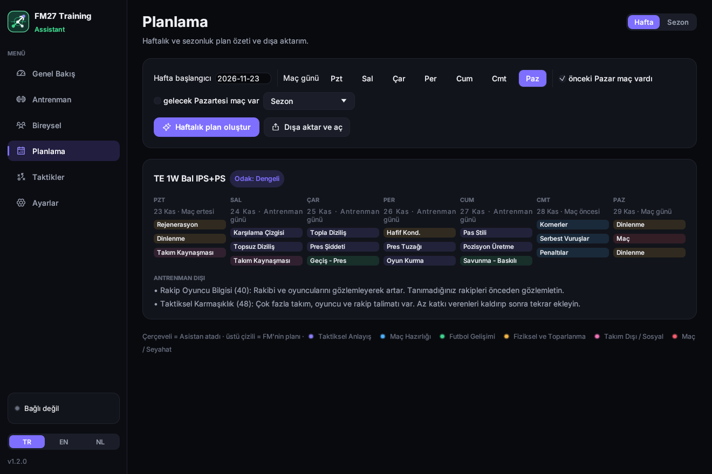

<p align="center">
  
</p>

<h1 align="center">FM27 Trainer (TR Fork)</h1>

<p align="center">
  <strong>Football Manager 27 için hilesiz, akıllı antrenman asistanı: takım takvimi otomasyonu, oyuncu bazlı taktik darboğaz raporu ve sakatlık önleyici bireysel yoğunluk.<br>
  A legitimate, no-cheat training assistant for Football Manager 27: team calendar automation, per-player tactical bottleneck report and injury-safe individual intensity.</strong>
</p>

<p align="center">
  
  
  
  
  
  
</p>

<p align="center">
  <a href="#türkçe">🇹🇷 Türkçe</a> ·
  <a href="#english">🇬🇧 English</a> ·
  <a href="../../releases/latest">Releases</a> ·
  <a href="docs/TECHNICAL.md">Technical notes</a>
</p>

<p align="center">
  
</p>

---

<a name="türkçe"></a>
## 🇹🇷 Türkçe

Bu proje, **[SemHiel2003/fm27-trainer](https://github.com/SemHiel2003/fm27-trainer)** (MIT) temel alınarak geliştirilmiş bir topluluk fork'udur. Odak noktası **tamamen meşru antrenman yönetimi**dir: oyuncu özellikleri, moral, kondisyon, bütçe ya da mevki bilgisi gibi değerlere **asla dokunulmaz**.

### Hilesizlik ilkesi

| Uygulama ne yapar | Uygulama ne yapmaz |
|---|---|
| FM'nin kendi antrenman takvimine seans yazar | Oyuncu özelliği / moral / kondisyon / keskinlik değiştirmez |
| FM'nin kendi *Bireysel Antrenman* menüsü olayıyla yoğunluk seçer | Bütçe, transfer, sakatlık, ceza, taktik anlayış düzenlemez |
| Kadro, kondisyon ve taktik verimliliğini **salt-okunur** okur | Kulüp / Kadro / Transfer editör ekranı içermez |

### Özellikler

**1. Takım antrenmanı otomasyonu**
- 17 Taktiksel Verimlilik faktörüne göre en zayıf alanlara odaklanan haftalık plan.
- **Taktik tarzı:** *Otomatik / Gegenpress / Tiki-Taka / Kanat & Hızlı Hücum / Savunma & Kontra*.
- **Kamp modları:** *Standart / Kondisyon Kampı / Oyuncu Gelişim Kampı / Derbi & Final Kampı*.
- **Otomatik korumalar:**
  - Kadro kondisyonu düşükse (varsayılan `%78`) veya haftada `2+` maç varsa otomatik *Daha fazla dinlenme*.
  - 8 taktik alanın tamamı `%85` üstündeyse otomatik *Gelişim modu*; biri düşünce taktiğe geri dönüş.
  - Maçsız haftaları *Milli Ara / Kış Arası* olarak tanıma.
  - Benimseme (*Buy-In*) için *Takım Kaynaşması* ve ilişkiler `%45` altındaysa *Sosyal Yardımlaşma*.
- **Planı koru:** FM yardımcısı takvimi bozarsa 8 saniyede bir kontrol edip geri yükler.
- **Haftalık etki özeti:** Her hafta için *Kondisyon, Yorgunluk, Mutluluk, Sakatlık Riski, Keskinlik*.

**2. Bireysel & Darboğaz sekmesi (yeni)**
- **Taktiği kim aşağı çekiyor?** Her oyuncunun taktik verimliliği en düşükten yükseğe sıralanır. *Taktik Anlayış, Rol Uyumu, Oyuncu Kalitesi* ve *Benimseme* skorlarından en zayıfı "ana darboğaz" olarak gösterilir ve pratik bir öneri verilir. `<65` filtresiyle yalnızca sorunlu oyuncular listelenebilir.
- **Sakatlık önleyici akıllı bireysel yoğunluk** (*Yarı / Normal / Çift*): yaş, kondisyon, maç keskinliği, sakatlık ve haftalık maç sayısına göre öneri:
  - Sakat veya kondisyon `<%70` → *Yarı* + maçta dinlendirme uyarısı.
  - Kondisyon `<%80` → *Yarı*.
  - `32+` yaş → en fazla *Normal*; yoğun haftada *Yarı*.
  - `2+` maçlı hafta → *Çift* kapalı (yalnızca diri ama ritimsiz rotasyon oyuncularına açık).
  - Rahat hafta + diri genç oyuncu → *Çift* (gelişim).
- Tek tıkla toplu uygulama, satır bazlı *Yarı / Normal / Çift* butonları ve isteğe bağlı otomatik koruma.

> [!NOTE]
> Bilinçli olarak **oyuncuları otomatik olarak taktikteki role zorlayan** bir özellik eklenmedi; yedek oyuncuların hiç uygun olmadığı rollere itilmesini önlemek için rol antrenmanı kararı menajerde kalır.

**3. BepInEx köprüsü — OCR'sız kesin okuma (opsiyonel)**
- `FM27Trainer.Bridge.dll` (v0.6.0), FM27'nin kendi `TeamTactic.TacticalEffectiveness` verisini oyunun içinden okur: **4 bileşen + 17 faktör, 0–100 tam sayı**, ve oyuncu bazlı skorlar.
- Bireysel yoğunluk değişikliklerini FM'nin resmi `EventFmxPlayerTrainingIntensityLevelChanged` olayıyla gönderir (bellek yazımı yok).
- Köprü yoksa ekran okuma (OCR) yedek olarak çalışmaya devam eder.

**4. Arayüz**
- Türkçe / English / Nederlands; sistem dilinden otomatik seçim.
- Türkçe OCR'da kısa etiket (*"Pas Stili"*) kesilme hatası düzeltildi.

### Kurulum (Windows)
1. **[Releases](../../releases/latest)** sayfasından **`FM27 Trainer.exe`** dosyasını indirip çalıştırın.
2. *(Önerilen)* FM27'de BepInEx 6 (Unity IL2CPP) kuruluysa **`FM27Trainer.Bridge.dll`** dosyasını `<FM27>\BepInEx\plugins\FM27Trainer.Bridge\` klasörüne kopyalayın ve oyunu yeniden başlatın.
3. FM27'de kaydınızı yükleyin; uygulama otomatik bağlanır.
4. Oyuncu darboğaz tablosunun dolması için oyunda **Taktiksel Verimlilik** ekranını bir kez açın.

---

<a name="english"></a>
## 🇬🇧 English

A community fork of **[SemHiel2003/fm27-trainer](https://github.com/SemHiel2003/fm27-trainer)** (MIT) focused on **fully legitimate training management**. Player attributes, morale, condition, finances and positional familiarity are **never modified**.

### No-cheat principle

| The app does | The app never does |
|---|---|
| Write sessions into FM's own training calendar | Change attributes / morale / condition / sharpness |
| Set intensity through FM's own *Individual Training* UI event | Edit finances, transfers, injuries, bans or tactical familiarity |
| Read squad, condition and tactical effectiveness **read-only** | Ship any Club / Squad / Transfer editor pages |

### Features

**1. Team training automation**
- Weekly plans targeting your weakest of the 17 Tactical Effectiveness factors.
- **Tactic style:** *Auto / Gegenpress / Possession / Wing & Fast Attack / Low Block & Counter*.
- **Camp modes:** *Standard / Fitness Camp / Player Development / Derby & Final Prep*.
- **Automatic guards:** extra rest on low squad condition (default `78%`) or `2+` match weeks; development mode once all 8 tactical areas exceed `85%`; international/winter break detection; relationship-focused Buy-In sessions.
- **Keep on plan:** restores your plan every 8 seconds if FM's assistant overwrites it.
- **Weekly impact summary:** *Condition, Fatigue, Happiness, Injury Risk, Sharpness* per week.

**2. Individual & Bottlenecks tab (new)**
- **Who drags the tactic down?** Players sorted from lowest to highest tactical effectiveness, with their weakest component (*Understanding, Role Suitability, Capability, Buy-In*) and practical advice. Optional `<65` filter.
- **Smart injury-safe individual intensity** (*Half / Normal / Double*) based on age, condition, match sharpness, injury status and weekly fixture load. Veterans (`32+`) are capped at *Normal*; *Double* is disabled in `2+` match weeks except for fresh, under-sharp rotation players.
- One-click bulk apply, per-row quick buttons and an optional auto-guard toggle.

> [!NOTE]
> There is intentionally **no automatic forcing of players into tactic roles**, so backups are never pushed into roles that do not suit them.

**3. Optional BepInEx bridge — exact OCR-free reading**
- `FM27Trainer.Bridge.dll` (v0.6.0) reads FM27's own `TeamTactic.TacticalEffectiveness` (4 components + 17 factors, exact 0–100) plus per-player scores.
- Sends individual intensity changes via FM's official `EventFmxPlayerTrainingIntensityLevelChanged` event (no memory writes).
- Screen OCR remains available as a fallback.

**4. Interface**
- Turkish / English / Dutch with automatic OS locale detection.

### Install (Windows)
1. Download **`FM27 Trainer.exe`** from **[Releases](../../releases/latest)** and run it.
2. *(Recommended)* With BepInEx 6 (Unity IL2CPP) installed, copy **`FM27Trainer.Bridge.dll`** into `<FM27>\BepInEx\plugins\FM27Trainer.Bridge\` and restart FM27.
3. Load your save; the app connects automatically.
4. Open the **Tactical Effectiveness** screen in FM once to populate the per-player bottleneck table.

### Build from source
```bash
# Desktop app (Rust stable)
cargo build --release -p fm27-trainer
cargo test --workspace

# Optional BepInEx 6 IL2CPP bridge (.NET 8 SDK)
dotnet build bridge/FM27Trainer.Bridge.csproj -c Release -p:FM27Dir="PATH_TO_FM27"
```

### Project layout
| Path | Purpose |
|---|---|
| `app/` | Desktop app (egui): planner, training, individual tab, OCR |
| `agent/` | Read-only FM27 memory reader + verified training-calendar writer |
| `bridge/` | Optional BepInEx 6 IL2CPP plugin (tactical data + intensity events) |

---

## Credits & License

- **Original project:** [SemHiel2003/fm27-trainer](https://github.com/SemHiel2003/fm27-trainer) by **Sem Hiel** (MIT).
- **Research & layouts:** FMSuperScout, FMLibreEditor, fm-lens, fmsave. Font: Inter (SIL OFL). Icons: Phosphor (MIT). See [THIRD_PARTY.md](THIRD_PARTY.md).
- **License:** [MIT](LICENSE)
