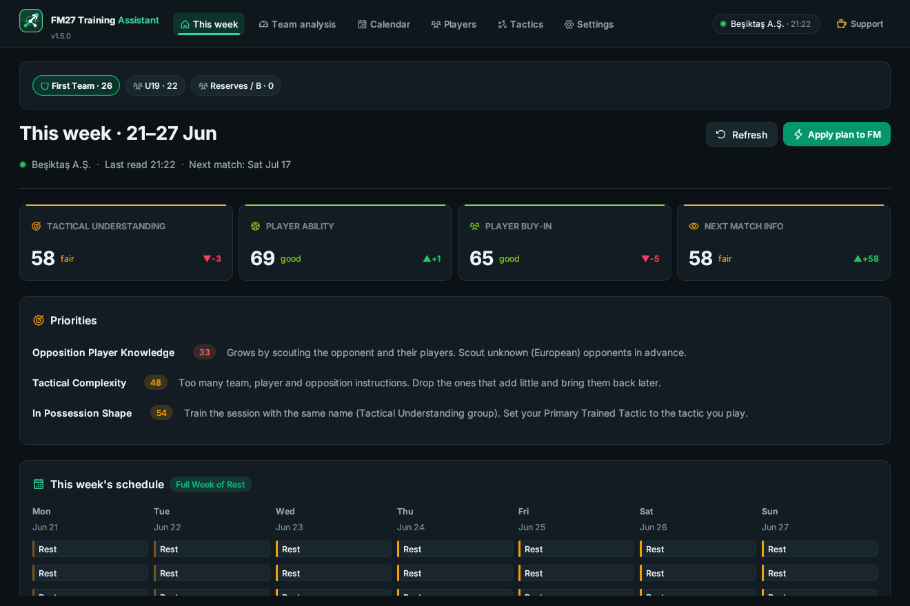
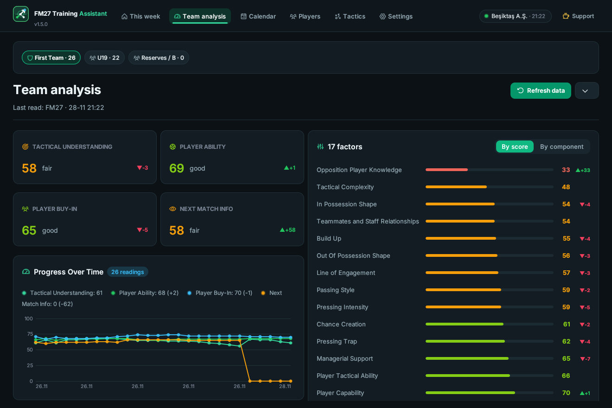
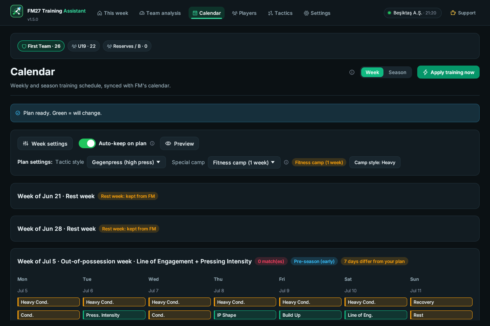
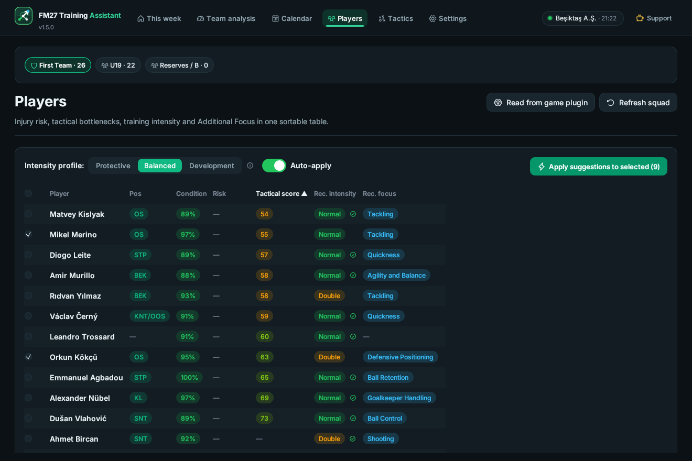

<p align="center">
  <a href="README.md">English</a> · <a href="README.tr.md">Türkçe</a>
</p>

<p align="center">
  
</p>

<h1 align="center">FM27 Training Assistant</h1>

<p align="center">
  A no-cheat desktop training assistant for Football Manager 27 that reads your team's tactical gaps, builds tailored schedules, and keeps individual workloads safe.
</p>

<p align="center">
  
  
  
  
</p>

<p align="center">
  <strong>Download:</strong>
  <a href="https://github.com/cilek14/fm27-trainer/releases/latest/download/FM27-Training-Assistant-Windows.zip"><strong>Windows (.zip)</strong></a>
  &nbsp;·&nbsp;
  <a href="https://github.com/cilek14/fm27-trainer/releases/latest/download/FM27-Training-Assistant-macOS.dmg"><strong>macOS (.dmg)</strong></a>
  &nbsp;·&nbsp;
  <a href="https://buymeacoffee.com/cilek14">☕ Buy Me a Coffee</a>
</p>

<p align="center">
  <sub>Supported UI languages: English · Türkçe · Deutsch · Nederlands · Français · Italiano · Español</sub>
</p>

---

<p align="center">
  
</p>

<!-- docs/images/demo.gif -->

## How it works

Everything lives in five focused views (**This week**, **Team analysis**, **Calendar**, **Players**, **Tactics**) and works in three steps:

### 1. Read

Open FM27 and load your save — the app captures all 4 Tactical Effectiveness components, 17 underlying factors, squad condition, tactical bottlenecks, and active youth squads.
Readings are saved per club so you can track `▲/▼` progress and the trend chart across your save (`Settings` remembers your club history).

<p align="center">
  
</p>

### 2. Plan

Pick your tactic style (`Auto (balanced)`, `Gegenpress`, `Possession`, `Wing & fast attack`, `Low block & counter`), special camp mode (`Standard (auto)`, `Pre-season fitness`, `Player development`, `Derby / final prep`), and pre-season intensity (`Heavy`, `Balanced`, `Tactical`) across all 59 official FM27 training sessions.
Busy 2+ match weeks or low squad condition automatically add extra rest, while First Team and U18/U19/U21/U23/B squads get dedicated schedules and **Academy Dev Mode**.

<p align="center">
  
</p>

### 3. Apply and protect

Write the generated week into FM27's calendar with one click, and enable **Auto-keep on plan** so any assistant manager override is restored automatically.
On **Players** and **Tactics**, apply injury-safe individual intensity (`Protective` / `Balanced` / `Development`), natural-position **Additional Focus**, and optional In-Possession / Out-of-Possession tactic role sync.

<p align="center">
  
</p>

> **What's new in v1.5.0:** Full support for Youth & Reserve teams (`U18/U19/U21/U23/B`) with Academy Dev Mode, interactive Pre-season & fitness camp intensity choice, Individual Intensity + position-aware Additional Focus + optional tactic role sync, and a redesigned UI.

---

## Is it a cheat?

**No.** Every action performed by FM27 Training Assistant mirrors manual training decisions available inside the game:

| ✅ What it does | ❌ What it never does |
|---|---|
| Writes weekly training sessions into FM27's calendar | Never boosts player attributes (CA/PA, pace, etc.) |
| Sets Individual Intensity, Additional Focus & optional role training via native UI events | Never edits morale, condition, fatigue, or match sharpness |
| Reads squad, fixtures, age, condition, and attributes **read-only** | Never touches budgets, transfers, injuries, or bans |

---

## Install

### Windows (10 / 11)

1. Download [**FM27-Training-Assistant-Windows.zip**](https://github.com/cilek14/fm27-trainer/releases/latest/download/FM27-Training-Assistant-Windows.zip), extract it anywhere, and launch **`FM27 Training Assistant.exe`** (portable, no installer required).
2. *(Recommended — optional game plugin `v0.9.1`)* If you use **BepInEx 6 (Unity IL2CPP)**, copy **`FM27Trainer.Bridge.dll`** into `<FM27 folder>\BepInEx\plugins\FM27Trainer.Bridge\` and restart FM27.
3. Load your save in FM27 — the app connects automatically:
   - Open **Tactical Effectiveness** in FM27 once to load exact factor scores and player bottlenecks.
   - Open **Individual Training** in FM27 once before applying **Additional Focus** or role training changes.

> Without the BepInEx plugin, Team analysis falls back cleanly to Windows screen text recognition.

### macOS (13+ Ventura or newer — Apple Silicon & Intel Universal)

1. Download [**FM27-Training-Assistant-macOS.dmg**](https://github.com/cilek14/fm27-trainer/releases/latest/download/FM27-Training-Assistant-macOS.dmg) and drag **`FM27 Training Assistant.app`** into **Applications**.
2. Because the app is open-source and not notarized with a paid Apple Developer ID, run this once in Terminal after moving it to Applications (or use **System Settings → Privacy & Security → Open Anyway**):
   ```bash
   xattr -cr "/Applications/FM27 Training Assistant.app"
   ```
3. The macOS build ships with `libfm27_agent.dylib` and native Apple Vision screen reading. If using screen capture fallback, enable `FM27 Training Assistant` under **System Settings → Privacy & Security → Screen Recording**.

---

## Compatibility

| Store / Platform | Read data | Write training plan | Notes |
|---|---|---|---|
| **Steam** (Windows & macOS) | ✅ Yes | ✅ Tested builds | Verified offsets; auto read-only after new FM patches |
| **Game Pass / Xbox app** (Windows) | ✅ Yes | ✅ Tested builds | Live agent connects when save is loaded |
| **New FM patch / Epic / Untested builds** | ✅ Yes | 🔒 Read-only by default | Enable writes per session only after checking squad & club match |

When Football Manager receives a patch and internal memory signatures change, the app automatically switches to **read-only mode** so it never writes bad data into your save. Once you verify that club name and squad look accurate in the app, you can toggle **`Allow writes on untested FM build`** under **`Settings → FM connection`** for the current session (back up your save first).

---

## Troubleshooting

### Not connecting checklist

1. Make sure **FM27 is running** and a **save is actively loaded** (not on the start menu).
2. Open the **Tactical Effectiveness** breakdown screen in FM27 at least once.
3. If using the optional game plugin on Windows, verify **`FM27Trainer.Bridge.dll`** (`v0.9.1`) is inside `<FM27 folder>\BepInEx\plugins\FM27Trainer.Bridge\` and FM27 was restarted after copying it.
4. For youth/reserve schedules (`U18/U19/U21/U23/B`), confirm you hold training responsibility for that squad under **Staff → Responsibilities** inside FM27.

### Sending diagnostic files

If something fails to read or looks wrong, attach these files from your app data folder (also shown with a one-click **Open folder** button in **`Settings → Folders`**):

- `last-analysis.txt`
- `last-breakdown.png`
- `last-capture.png`

Folder locations:
- **Windows:** `%APPDATA%\FM27 Trainer` (`C:\Users\<user>\AppData\Roaming\FM27 Trainer`)
- **macOS:** `~/Library/Application Support/FM27 Trainer`

👉 [**Open a bug report on GitHub**](https://github.com/cilek14/fm27-trainer/issues/new)

---

## FAQ

<details>
<summary><strong>Windows Defender / my browser shows a virus warning</strong></summary>

This is a **false positive**. The Windows executable is unsigned and uses Win32 APIs to attach to `fm.exe` and read training/squad memory — heuristics that Defender and Chromium browsers commonly flag on open-source game tools without a paid EV code-signing certificate. You can inspect the entire Rust and C# source code in this repository, build from source yourself, or verify downloads against `SHA256SUMS.txt` on each release. If Defender quarantines the archive, add an exclusion for the extracted folder in **Windows Security → Virus & threat protection**.

</details>

<details>
<summary><strong>SmartScreen: "Windows protected your PC"</strong></summary>

Because the binary is not signed with an Authenticode certificate, Windows SmartScreen asks for confirmation on first run. Click **More info**, verify the file name (`FM27 Training Assistant.exe`), and click **Run anyway**.

</details>

<details>
<summary><strong>Will this corrupt my save file?</strong></summary>

Before anything is written to FM27's calendar, the app validates the week layout, session IDs, and original memory bytes, and automatically reverts if a check fails. Changes stay in memory only until you click **Save** inside Football Manager — though keeping a backup before major pre-season writes is always good practice.

</details>

<details>
<summary><strong>macOS shows "developer cannot be verified" (Gatekeeper)</strong></summary>

macOS applies a quarantine attribute to `.dmg`/`.app` bundles downloaded from the internet without Apple notarization. After dragging the app into `/Applications`, run `xattr -cr "/Applications/FM27 Training Assistant.app"` once in Terminal or click **Open Anyway** in **System Settings → Privacy & Security**.

</details>

<details>
<summary><strong>Why doesn't it force every player into their tactic role by default?</strong></summary>

Versatile squad players covering secondary positions shouldn't be pushed into training roles that clash with their best attributes. By default, **Players** recommends **Additional Focus** for each player's natural position and weakest key attributes (avoiding heavy physical drills for injured or `32+` veterans). If you want tactic role training synced too, enable In-Possession / Out-of-Possession role sync explicitly in the Players view.

</details>

<details>
<summary><strong>What happens when FM27 gets a game update?</strong></summary>

If safety validation cannot confirm the calendar structure or build offsets after an update, the app drops into read-only mode automatically instead of risking an unsafe write.

</details>

---

<details>
<summary><strong>For developers</strong></summary>

```bash
# Desktop app & agent tests (Rust)
cargo test --workspace
cargo build --release -p fm27-trainer

# macOS Universal .app & .dmg bundle (run on macOS)
./release.sh

# Optional BepInEx 6 IL2CPP bridge (.NET 6 / .NET 8 SDK)
dotnet build bridge/FM27Trainer.Bridge.csproj -c Release -p:FM27Dir="PATH_TO_FM27"
```

| Path | Contents |
|---|---|
| `app/` | Desktop app: planner, calendar, history trend chart, individual & tactics views |
| `agent/` | Read-only FM27 memory reader + structurally verified training-calendar writer |
| `bridge/` | Optional BepInEx 6 IL2CPP plugin (`v0.9.1`): exact tactical data + intensity/focus/role events |

Technical notes: [docs/TECHNICAL.md](docs/TECHNICAL.md)

</details>

## Credits and license

- License: [GNU General Public License v3.0 (GPL-3.0)](LICENSE)
- Original upstream project: [SemHiel2003/fm27-trainer](https://github.com/SemHiel2003/fm27-trainer) by **Sem Hiel** — full notice in [LICENSE-UPSTREAM-MIT](LICENSE-UPSTREAM-MIT).
- Research & layouts: FMSuperScout, FMLibreEditor, fm-lens, fmsave. Font: Inter (SIL OFL). Icons: Phosphor (MIT). See [THIRD_PARTY.md](THIRD_PARTY.md).
