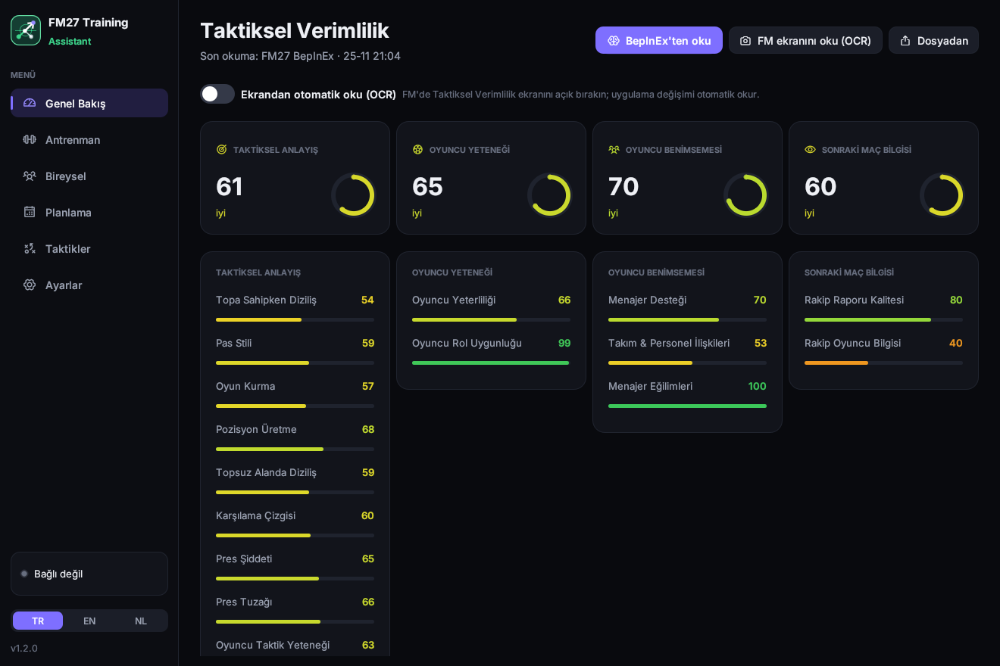
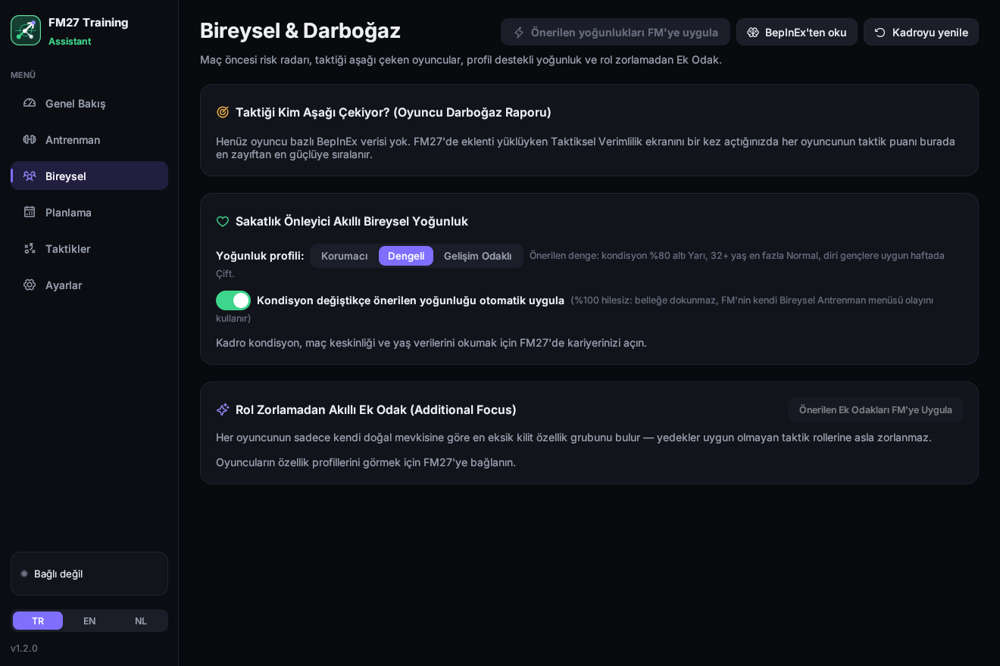

<p align="center">
  
</p>

<h1 align="center">FM27 Training Assistant</h1>

<p align="center">
  <strong>Football Manager 27 için hilesiz, akıllı antrenman asistanı.<br>
  A no-cheat, smart training assistant for Football Manager 27.</strong>
</p>

<p align="center">
  
  
  
  
  
  
</p>

<p align="center">
  <a href="#türkçe">🇹🇷 Türkçe</a> ·
  <a href="#english">🇬🇧 English</a> ·
  <a href="../../releases/latest">İndir / Download</a>
</p>

<p align="center">
  
</p>

<p align="center">
  
  &nbsp;
  
</p>

---

<a name="türkçe"></a>
## 🇹🇷 Türkçe

### Bu program ne işe yarar?

FM27'de her hafta antrenman takvimi kurmak, yorgun oyuncuları kollamak ve eksik alanları takip etmek çok zaman alır. **FM27 Training Assistant** bunları senin yerine düzenli ve hilesiz şekilde yapar:

- Takımının **hangi taktik konularda zayıf olduğuna** bakar ve haftalık programı buna göre hazırlar.
- **Zaman içindeki taktiksel gelişimini** (`▲+X` / `▼-X` farkları ve trend grafiğiyle) kaydedip gösterir.
- Kadro yorgunluğunu ve yoğun maç takvimini görüp **gerektiğinde otomatik dinlendirir**.
- **Taktiği aşağı çeken oyuncuları** ve nerede zorlandıklarını listeler.
- Her oyuncu için **sakatlık önleyici bireysel yoğunluk** ve **rol zorlamadan Ek Odak (Additional Focus)** önerir.

### Hile var mı?

**Hayır.** Program yalnızca oyunun kendi içinde senin de elle yapabileceğin işlemleri uygular:

| ✅ Ne yapar? | ❌ Ne yapmaz? |
|---|---|
| FM27'nin antrenman takvimine seans yazar | Oyuncu özelliklerini (CA/PA, hız vb.) yükseltmez |
| Bireysel yoğunluğu ve Ek Odak seçimini FM menüsünden uygular | Moral, kondisyon veya maç keskinliği düzenlemez |
| Kadro, fikstür, yaş ve özellik bilgilerini **salt-okunur** okur | Bütçe, transfer, sakatlık veya ceza değiştirmez |

### Ekranlar ve özellikler

**📊 Genel Bakış — Taktiksel Verimlilik & Gelişim Trendi**
- 4 ana bileşen ve 17 faktör tamamen Türkçe isimleriyle gösterilir.
- Kulübün için önceki ölçümlere göre değişimler (`▲+5`, `▼-2`) ve **Zaman İçinde Gelişim Trendi** grafiği otomatik oluşur.

**📅 Antrenman & Planlama — Takım Antrenmanı**
- 62 FM27 seansının tamamı Türkçe adlarıyla görünür (üzerine gelince İngilizcesi de çıkar).
- Oyun tarzı (`Gegenpress`, `Tiki-Taka`, `Kanat`, `Savunma & Kontra`, `Otomatik`) ve özel kamp modları (`Kondisyon`, `Oyuncu Gelişimi`, `Derbi/Final`) seçilebilir.
- Kadro yorulursa (`< %78` veya haftada `2+` maç) otomatik daha fazla dinlenme koyar; 8 taktik alan `%85` üstüne çıktığında otomatik gelişim moduna geçer.
- FM yardımcı antrenörü programı değiştirirse 8 saniyede bir kontrol edip senin planını geri koyar.

**👤 Bireysel & Darboğaz — Oyuncu Yönetimi**
- **Maç Öncesi Risk Radarı:** Haftalık maç sayısı, kritik kondisyonlu/sakat oyuncu sayısı, korumadaki veteranlar ve kadro hazırlığı.
- **"Taktiği kim aşağı çekiyor?"**: Oyuncuları taktik uyum puanına göre en düşükten yükseğe sıralar, asıl sorununu (*Taktik Anlayış, Rol Uyumu, Kalite, Benimseme*) gösterir.
- **Akıllı Yoğunluk + 3 Profil (`Korumacı` / `Dengeli` / `Gelişim Odaklı`):** Yaş, kondisyon, maç keskinliği, sakatlık ve haftalık maç yüküne göre *Yarı / Normal / Çift* önerir ve tek tıkla FM'ye uygular.
- **Rol Zorlamadan Ek Odak (*Additional Focus*):** Her oyuncunun sadece kendi doğal mevkisindeki (*Kaleci, Stoper, Bek, Orta Saha, Kanat/OOS, Santrfor*) en düşük kilit özellik grubunu bulur; sakat ve `32+` yaş oyunculara fiziksel yük bindirmeyen odak önerir.

**🎯 Taktikler**
- Seçili taktiğe göre en iyi ilk 11 yerleşimini ve daha uygun rol önerilerini gösterir (salt-okunur).

### Kurulum ve İlk Kullanım (3 Adım)

1. **[İndirme sayfasından](../../releases/latest)** `FM27 Trainer.exe` dosyasını indirip çalıştır (kurulum gerektirmez).
2. *(Önerilen — BepInEx eklentisi `v0.7.0`)* Oyununda **BepInEx 6 (Unity IL2CPP)** kuruluysa `FM27Trainer.Bridge.dll` dosyasını şu klasöre kopyala ve FM27'yi yeniden başlat:
   ```
   <FM27 klasörü>\BepInEx\plugins\FM27Trainer.Bridge\
   ```
3. FM27'de kariyerini aç — uygulama otomatik bağlanır:
   - Oyuncu bazlı darboğaz verilerinin gelmesi için oyunda **Taktiksel Verimlilik** ekranını bir kez aç.
   - Ek Odak'ı tek tıkla oyuna uygulamak için FM27'de **Bireysel Antrenman** sekmesini bir kez aç.

> BepInEx kurulu değilse bile uygulama çalışmaya devam eder; taktik değerlerini ekran görüntüsünden (OCR) okur.

### Sık Sorulan Sorular

<details>
<summary><strong>Kayıt dosyam (save) bozulur mu?</strong></summary>

Antrenman takvimi yazılmadan önce hafta yapısı, geçerli seans kodları ve eski baytlar tek tek doğrulanır; sorun olursa işlem geri sarılır. Değişiklikler sen FM27 içinde **Kaydet** diyene kadar kalıcı olmaz. Yine de her ihtimale karşı yedek alman önerilir.

</details>

<details>
<summary><strong>Oyuncuları neden otomatik olarak taktikteki role zorlamıyor?</strong></summary>

Asıl mevkisi dışında rotasyonda kullanılan oyuncular (örneğin sağ beke çekilen bir stoper ya da kanat oynayan bir forvet) kendi özelliklerine hiç uymayan bir rol antrenmanına zorlanmasın diye bu özellik bilinçli olarak eklenmedi. Bunun yerine sadece oyuncunun doğal mevkisindeki zayıf özellikleri hedefleyen **Ek Odak** önerisi sunulur.

</details>

<details>
<summary><strong>FM27'ye yeni güncelleme gelirse ne olur?</strong></summary>

Güvenlik kontrolü tarih veya takvim yapısını doğrulayamazsa uygulama otomatik olarak salt-okunur moda geçer ve oyunun belleğine yazmaz.

</details>

---

<a name="english"></a>
## 🇬🇧 English

### What does it do?

Managing training schedules, player fatigue and individual development by hand every week in FM27 takes time. **FM27 Training Assistant** automates the routine parts cleanly and without cheats:

- Inspects **your team's weakest tactical areas** and builds weekly schedules around them.
- Tracks **Tactical Effectiveness progress over time** (`▲+X` / `▼-X` deltas and a trend chart).
- Detects low squad condition and `2+` match weeks and **adds recovery/rest automatically**.
- Lists **which players drag your tactical effectiveness down** and why.
- Recommends **injury-safe individual intensity** and **role-free Additional Focus** per player.

### Is it a cheat?

**No.** Everything the app does mirrors actions you can perform manually inside FM:

| ✅ What it does | ❌ What it never does |
|---|---|
| Writes sessions into FM27's training calendar | Never boosts player attributes |
| Sets Individual Intensity & Additional Focus via native UI events | Never alters morale, condition or match sharpness |
| Reads squad, fixtures, age and attributes **read-only** | Never touches finances, transfers, injuries or bans |

### Screens & Features

- **📊 Overview — Tactical Effectiveness & Trend:** Exact 4 components + 17 factors, `▲/▼` changes from previous readings, and a club-scoped progress line chart.
- **📅 Training & Planning:** Style modes (*Auto, Gegenpress, Possession, Wing Attack, Low Block & Counter*), Camp modes (*Standard, Fitness, Development, Derby/Final*), automatic break detection, and 8-second calendar protection against FM assistant overrides.
- **👤 Individual & Bottlenecks:**
  - **Pre-match Risk Radar** (weekly matches, critical fatigue/injury count, guarded veterans, readiness).
  - **"Who drags the tactic down?"** bottleneck report sorted from lowest tactical fit.
  - **Smart Intensity + 3 Profiles (`Protective` / `Balanced` / `Development`)** recommending *Half / Normal / Double*.
  - **Role-free Additional Focus** tailored strictly to each player's natural position and weakest attribute group (skipping heavy physical focuses for injured or `32+` players).
- **🎯 Tactics:** Read-only best XI and role suitability helper.

### Install & First Use (3 Steps)

1. Download **`FM27 Trainer.exe`** from **[Releases](../../releases/latest)** and run it (no installer needed).
2. *(Recommended — BepInEx Plugin `v0.7.0`)* If you have **BepInEx 6 (Unity IL2CPP)** installed, copy **`FM27Trainer.Bridge.dll`** into `<FM27 folder>\BepInEx\plugins\FM27Trainer.Bridge\` and restart FM27.
3. Load your save in FM27 — the app connects automatically:
   - Open **Tactical Effectiveness** in FM once to populate the per-player bottleneck list.
   - Open **Individual Training** in FM once to enable one-click **Additional Focus** writes.

> Without the BepInEx plugin, the app still works using screen OCR fallback.

### FAQ

<details>
<summary><strong>Why doesn't it auto-force players into tactic slot roles?</strong></summary>

Backups or versatile players covering secondary positions shouldn't be forced to train roles that clash with their attributes. Instead, **Additional Focus** targets each player's weakest attributes in their own natural position.

</details>

---

<details>
<summary><strong>For developers / Geliştiriciler için</strong></summary>

```bash
# Desktop app & agent tests (Rust)
cargo test --workspace
cargo build --release -p fm27-trainer

# Optional BepInEx 6 IL2CPP bridge (.NET 8 SDK)
dotnet build bridge/FM27Trainer.Bridge.csproj -c Release -p:FM27Dir="PATH_TO_FM27"
```

| Path | Contents |
|---|---|
| `app/` | Desktop app: planner, training, history trend chart, individual & tactics tabs, OCR |
| `agent/` | Read-only FM27 memory reader + structurally verified training-calendar writer |
| `bridge/` | Optional BepInEx 6 IL2CPP plugin (`v0.7.0`): exact tactical data + intensity/focus events |

Technical notes: [docs/TECHNICAL.md](docs/TECHNICAL.md)

</details>

## Credits & License

- Original project: [SemHiel2003/fm27-trainer](https://github.com/SemHiel2003/fm27-trainer) by **Sem Hiel** (MIT).
- Research & layouts: FMSuperScout, FMLibreEditor, fm-lens, fmsave. Font: Inter (SIL OFL). Icons: Phosphor (MIT). See [THIRD_PARTY.md](THIRD_PARTY.md).
- License: [MIT](LICENSE)
