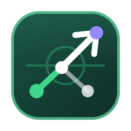
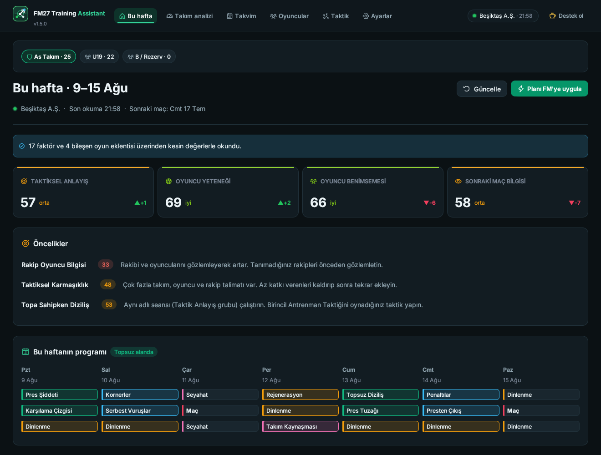
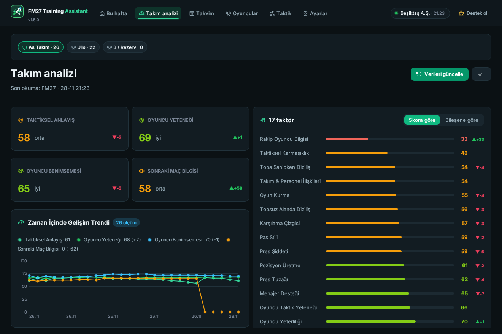
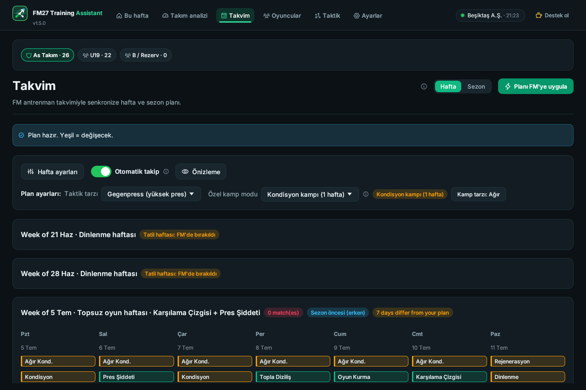
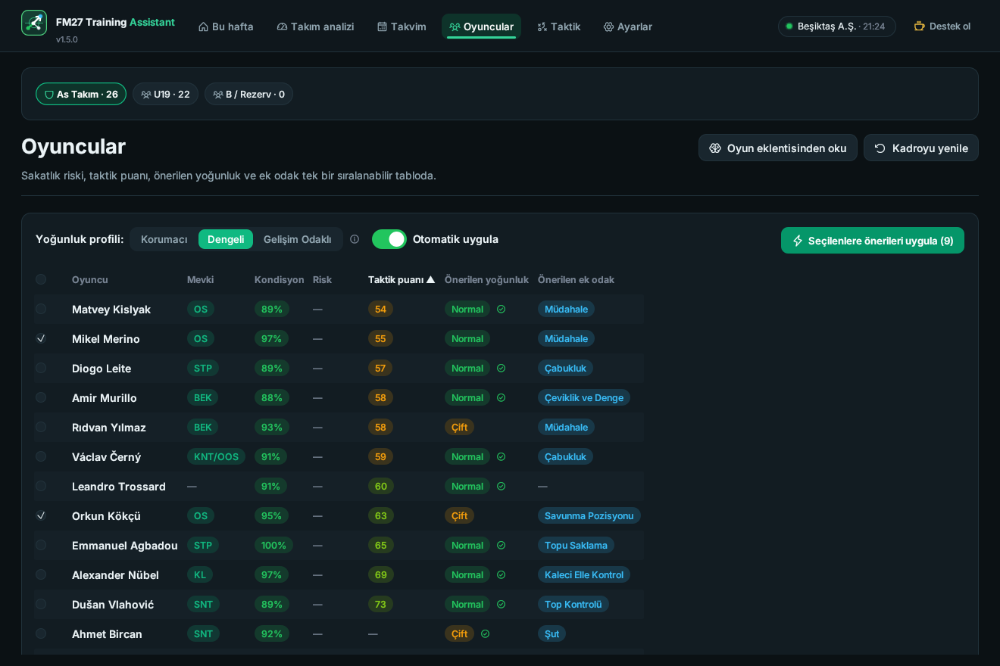

<p align="center">
  <a href="README.md">English</a> · <a href="README.tr.md">Türkçe</a>
</p>

<p align="center">
  
</p>

<h1 align="center">FM27 Training Assistant</h1>

<p align="center">
  Football Manager 27 için takımınızın taktiksel açıklarını okuyan, maça göre haftalık program kuran ve oyuncu yükünü koruyan hilesiz antrenman asistanı.
</p>

<p align="center">
  
  
  
  
</p>

<p align="center">
  <strong>İndir:</strong>
  <a href="https://github.com/cilek14/fm27-trainer/releases/latest/download/FM27-Training-Assistant-Windows.zip"><strong>Windows (.zip)</strong></a>
  &nbsp;·&nbsp;
  <a href="https://github.com/cilek14/fm27-trainer/releases/latest/download/FM27-Training-Assistant-macOS.dmg"><strong>macOS (.dmg)</strong></a>
  &nbsp;·&nbsp;
  <a href="https://buymeacoffee.com/cilek14">☕ Buy Me a Coffee</a>
</p>

<p align="center">
  <sub>Desteklenen arayüz dilleri: Türkçe · English · Deutsch · Nederlands · Français · Italiano · Español</sub>
</p>

---

<p align="center">
  
</p>

<!-- docs/images/demo.gif -->

## Nasıl çalışır?

Uygulama beş sade ekrandan (**Bu hafta**, **Takım analizi**, **Takvim**, **Oyuncular**, **Taktik**) oluşur ve üç adımda çalışır:

### 1. Oku

FM27'yi açıp kariyerinizi yüklediğinizde uygulama 4 Taktiksel Verimlilik bileşenini, 17 alt faktörü, kadro kondisyonunu, darboğazları ve altyapı takımlarını otomatik olarak okur.
Okumalar kulübünüze göre kaydedilir; böylece zaman içindeki `▲/▼` değişimini ve gelişim grafiğini sezon boyunca takip edebilirsiniz.

<p align="center">
  
</p>

### 2. Planla

59 resmi FM27 antrenman seansını kullanarak taktik tarzınızı (`Otomatik (dengeli)`, `Gegenpress`, `Topa sahip olma`, `Kanat & hızlı hücum`, `Alçak blok & kontra`), özel kamp modunu (`Standart (otomatik)`, `Sezon öncesi kondisyon`, `Oyuncu gelişimi`, `Derbi / final hazırlığı`) ve kamp yoğunluğunu (`Ağır`, `Dengeli`, `Taktik`) seçin.
Haftada 2+ maç olan yoğun dönemlerde veya kondisyon düştüğünde ekstra dinlenme eklenir; As Takım yanında U18/U19/U21/U23/B kadroları için de **Akademi Gelişim Modu** ile ayrı plan hazırlanır.

<p align="center">
  
</p>

### 3. Uygula ve koru

Oluşturulan haftalık programı tek tıkla FM27 takvimine yazın ve **Otomatik takip**'i açarak yardımcı antrenörün planı bozmasını otomatik geri alın.
**Oyuncular** ve **Taktik** ekranlarında sakatlık riskini azaltan bireysel yoğunluk (`Korumacı` / `Dengeli` / `Gelişim`), oyuncunun kendi mevkisine uygun **Ek Odak** ve isteğe bağlı Topla / Topsuz taktik rolü senkronizasyonu uygulayın.

<p align="center">
  
</p>

> **v1.5.0 yenilikleri:** Genç ve rezerv takımlar (`U18/U19/U21/U23/B`) + Akademi Gelişim Modu, sezon öncesi ve kondisyon kampı yoğunluğu seçimi, bireysel yoğunluk profilleri + mevkiye özel Ek Odak + isteğe bağlı rol senkronizasyonu ve baştan yenilenen arayüz.

---

## Hile mi?

**Hayır.** Program yalnızca oyun içinde elinizle de yapabileceğiniz antrenman işlemlerini otomatikleştirir:

| ✅ Ne yapar? | ❌ Ne yapmaz? |
|---|---|
| FM27'nin antrenman takvimine haftalık seansları yazar | Oyuncu özelliklerini (CA/PA, hız vb.) yükseltmez |
| Bireysel yoğunluk, Ek Odak ve isteğe bağlı rol eğitimini oyunun arayüz olaylarıyla uygular | Moral, kondisyon, yorgunluk veya maç keskinliğini değiştirmez |
| Kadro, fikstür, yaş, kondisyon ve özellikleri **salt-okunur** okur | Bütçe, transfer, sakatlık veya cezaya dokunmaz |

---

## Kurulum

### Windows (10 / 11)

1. [**FM27-Training-Assistant-Windows.zip**](https://github.com/cilek14/fm27-trainer/releases/latest/download/FM27-Training-Assistant-Windows.zip) dosyasını indirin, istediğiniz klasöre çıkarın ve **`FM27 Training Assistant.exe`** dosyasını çalıştırın (kurulum gerektirmez).
2. *(Önerilen — isteğe bağlı oyun eklentisi `v0.9.1`)* Oyununuzda **BepInEx 6 (Unity IL2CPP)** kuruluysa **`FM27Trainer.Bridge.dll`** dosyasını sürüm arşivindeki `BepInEx-plugin/FM27Trainer.Bridge/` (veya `BepInEx/plugins/FM27Trainer.Bridge/`) klasöründen ya da [son sürüm sayfasındaki](https://github.com/cilek14/fm27-trainer/releases/latest) **`FM27Trainer.Bridge.dll`** ek dosyasından alıp `<FM27 klasörü>\BepInEx\plugins\FM27Trainer.Bridge\` içine kopyalayın ve FM27'yi yeniden başlatın.
3. FM27'de kariyerinizi açın — uygulama oyuna otomatik bağlanır:
   - Faktör skorlarının ve oyuncu darboğazlarının okunması için oyunda **Taktiksel Verimlilik** ekranını bir kez açın.
   - **Ek Odak** veya rol eğitimi göndermeden önce FM27'de **Bireysel Antrenman** sekmesini bir kez açın.

> Oyun eklentisi kurulu olmasa bile Takım analizi Windows ekran tanıma desteğiyle çalışmaya devam eder.

### macOS (13+ Ventura ve üzeri — Apple Silicon & Intel Universal)

1. [**FM27-Training-Assistant-macOS.dmg**](https://github.com/cilek14/fm27-trainer/releases/latest/download/FM27-Training-Assistant-macOS.dmg) dosyasını indirin ve **`FM27 Training Assistant.app`** uygulamasını **Applications (Uygulamalar)** klasörüne sürükleyin.
2. Açık kaynaklı olduğu ve ücretli Apple Developer kimliğiyle noter onayı yapılmadığı için ilk çalıştırmada Terminal'den şu komutu bir kez çalıştırın (veya **Sistem Ayarları → Gizlilik ve Güvenlik → Yine de Aç** deyin):
   ```bash
   xattr -cr "/Applications/FM27 Training Assistant.app"
   ```
3. macOS sürümü `libfm27_agent.dylib` ve yerleşik Apple Vision ekran okuma desteğiyle gelir. Ekran yakalama yedeğini kullanacaksanız **Sistem Ayarları → Gizlilik ve Güvenlik → Ekran Kaydı** altından `FM27 Training Assistant` iznini verin.

---

## Uyumluluk

| Platform / Mağaza | Veri okuma | Antrenman yazma | Notlar |
|---|---|---|---|
| **Steam** (Windows & macOS) | ✅ Evet | ✅ Doğrulanmış sürümler | Bellek düzeni doğrulamalı; güncelleme gelirse salt-okunura geçer |
| **Game Pass / Xbox uygulaması** (Windows) | ✅ Evet | ✅ Doğrulanmış sürümler | Kariyer yüklendiğinde otomatik bağlanır |
| **Yeni FM yaması / Epic / Test edilmemiş sürüm** | ✅ Evet | 🔒 Varsayılan olarak salt-okunur | Kadro doğru görünüyorsa oturumluk olarak yazma açılabilir |

FM27 yeni bir güncelleme aldığında ve uygulama bellek yapısını doğrulayamadığında, kaydınıza yanlış veri yazmamak için otomatik olarak **salt-okunur moda** geçer. Kulüp adı ve kadronun uygulamada doğru göründüğünü kontrol ettikten sonra **`Ayarlar → FM bağlantısı`** bölümündeki **`Test edilmemiş FM sürümünde yazmaya izin ver`** seçeneğini yalnızca o oturum için açabilirsiniz (önce kayıt yedeği almanız önerilir).

---

## Sorun giderme

### Bağlanmıyor kontrol listesi

1. **FM27 açık** ve bir **kariyer kaydı yüklenmiş** mi (ana menüde değil)?
2. Oyunda **Taktiksel Verimlilik** döküm ekranı en az bir kez açıldı mı?
3. Windows'ta oyun eklentisini kullanıyorsanız **`FM27Trainer.Bridge.dll`** (`v0.9.1`) dosyasının `<FM27 klasörü>\BepInEx\plugins\FM27Trainer.Bridge\` klasöründe olduğundan ve kopyaladıktan sonra FM27'nin yeniden başlatıldığından emin olun.
4. Altyapı/rezerv takımlar (`U18/U19/U21/U23/B`) için takvim okumak/yazmak adına FM27'de **Personel → Sorumluluklar** altından ilgili takımın antrenman kontrolünü üstlenmeniz gerekir.

### Hata bildirirken gönderilecek dosyalar

Bir okuma hatası veya yanlış sonuç görürseniz uygulama veri klasöründeki şu dosyaları (uygulamada **`Ayarlar → Klasörler → Klasörü aç`** ile kolayca bulabilirsiniz) hata kaydına ekleyin:

- `last-analysis.txt`
- `last-breakdown.png`
- `last-capture.png`

Klasör yolları:
- **Windows:** `%APPDATA%\FM27 Trainer` (`C:\Users\<kullanıcı>\AppData\Roaming\FM27 Trainer`)
- **macOS:** `~/Library/Application Support/FM27 Trainer`

👉 [**GitHub üzerinden hata bildirimi açın**](https://github.com/cilek14/fm27-trainer/issues/new)

---

## Sık Sorulan Sorular

<details>
<summary><strong>Windows Defender / tarayıcı virüs uyarısı veriyor</strong></summary>

Bu tamamen **yanlış alarmdır (false positive)**. Windows uygulaması dijital sertifika ile imzalanmadığı ve `fm.exe` sürecinin belleğini okuyup yazdığı için Defender ve Chromium tabanlı tarayıcılar imzasız açık kaynak araçları şüpheli işaretleyebiliyor. Tüm Rust ve C# kaynak kodları bu depoda açıktır; dilerseniz kendiniz derleyebilir veya indirdiğiniz dosyayı sürüm sayfasındaki `SHA256SUMS.txt` ile doğrulayabilirsiniz. Defender arşivi karantinaya alırsa çıkardığınız klasörü **Windows Güvenliği → Virüs ve tehdit koruması** altından dışlamalara ekleyebilirsiniz.

</details>

<details>
<summary><strong>SmartScreen: "Windows bilgisayarınızı korudu" uyarısı çıkıyor</strong></summary>

Uygulama ücretli Authenticode sertifikasıyla imzalanmadığı için ilk çalıştırmada Windows SmartScreen onay ister. Pencerede **Ek bilgi** bağlantısına tıklayıp dosya adını (`FM27 Training Assistant.exe`) doğruladıktan sonra **Yine de çalıştır**'a basın.

</details>

<details>
<summary><strong>Kayıt dosyam (save) bozulur mu?</strong></summary>

FM27 takvimine yazmadan önce hafta yapısı, geçerli seans kodları ve eski bellek baytları doğrulanır; beklenmedik bir farkta işlem geri alınır. Değişiklikler siz FM27 içinde **Kaydet** diyene kadar diske yazılmaz. Yine de sezon başı büyük değişikliklerden önce kayıt yedeği almanız önerilir.

</details>

<details>
<summary><strong>macOS'ta "geliştirici doğrulanamadı" (Gatekeeper) uyarısı çıkıyor</strong></summary>

Ücretli Apple Developer noter onayı olmadığı için tarayıcıdan inen `.dmg`/`.app` paketlerine macOS karantina uygular. Uygulamayı `/Applications` klasörüne taşıdıktan sonra Terminal'de bir kez `xattr -cr "/Applications/FM27 Training Assistant.app"` komutunu çalıştırın veya **Sistem Ayarları → Gizlilik ve Güvenlik → Yine de Aç** seçeneğini kullanın.

</details>

<details>
<summary><strong>Oyuncuları neden varsayılan olarak taktikteki role zorlamıyor?</strong></summary>

Asıl mevkisi dışında rotasyonda kullanılan çok yönlü oyuncular, kendi özellik profiliyle örtüşmeyen bir rol antrenmanına zorlanmasın diye varsayılan olarak zorlama yapılmaz. Bunun yerine **Oyuncular** sayfası her oyuncunun doğal mevkisindeki en zayıf kilit özelliklere göre **Ek Odak** önerir (sakat ve `32+` yaş oyunculara ağır yük bindirmez). Taktik rolü senkronizasyonu isterseniz **Oyuncular** sayfasından isteğe bağlı açabilirsiniz.

</details>

<details>
<summary><strong>FM27'ye güncelleme gelirse ne olur?</strong></summary>

Güvenlik kontrolü tarih veya takvim yapısını doğrulayamazsa uygulama bellek yazmayı kendiliğinden durdurur ve yalnızca okuma modunda çalışır.

</details>

---

<details>
<summary><strong>Geliştiriciler için</strong></summary>

```bash
# Masaüstü uygulaması ve agent testleri (Rust)
cargo test --workspace
cargo build --release -p fm27-trainer

# macOS Universal .app & .dmg paketi (macOS üzerinde çalıştırılır)
./release.sh

# İsteğe bağlı BepInEx 6 IL2CPP eklentisi (.NET 6 / .NET 8 SDK; yerel FM27 + BepInEx interop klasörü gerektirir)
dotnet build bridge/FM27Trainer.Bridge.csproj -c Release -p:FM27Dir="FM27_YOLU"
```

| Klasör | İçerik |
|---|---|
| `app/` | Masaüstü arayüzü: planlayıcı, takvim, gelişim grafiği, oyuncular ve taktik ekranları |
| `agent/` | Salt-okunur FM27 bellek okuyucu + yapısal doğrulamalı antrenman takvimi yazıcı |
| `bridge/` | İsteğe bağlı BepInEx 6 IL2CPP eklentisi (`v0.9.1`): kesin taktik verisi + yoğunluk/odak/rol olayları |

Teknik notlar: [docs/TECHNICAL.md](docs/TECHNICAL.md)

</details>

## Teşekkür ve lisans

- Lisans: [GNU General Public License v3.0 (GPL-3.0)](LICENSE)
- Orijinal upstream proje: [SemHiel2003/fm27-trainer](https://github.com/SemHiel2003/fm27-trainer) (**Sem Hiel**) — detaylar için [LICENSE-UPSTREAM-MIT](LICENSE-UPSTREAM-MIT).
- Araştırma ve veri düzeni: FMSuperScout, FMLibreEditor, fm-lens, fmsave. Yazı tipi: Inter (SIL OFL). Simgeler: Phosphor (MIT). Ayrıntılar için [THIRD_PARTY.md](THIRD_PARTY.md).
